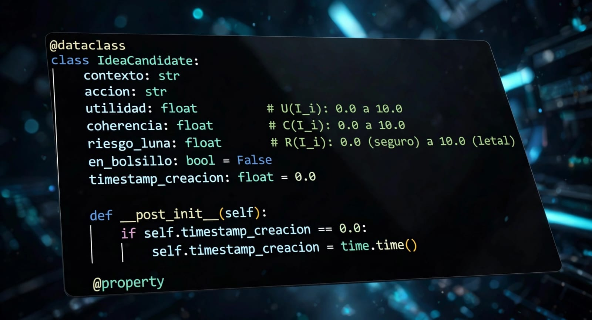

## ⚡ bsl-core
Procesador Híbrido Cognitivo BSL Core y Metamodelo Universal de Gobernanza

# BSL Core: Procesador Híbrido Cognitivo (Bufón, Sol y Luna)

> **Autor y Arquitecto Principal:** Victor Adrian Alcantara Gallardo  
> **Metamodelo de Gobernanza y Arquitectura de Autonomía**

---

## 🏛️ Descripción General

**BSL Core** es un procesador híbrido cognitivo y metamodelo universal de gobernanza diseñado desde cero para superar la rigidez y la fuerza bruta de los sistemas tradicionales de Inteligencia Artificial. La arquitectura integra **12 leyes lógicas de control y dinámica metabólica**, persistencia estructurada (JSONL/SQLite) y un eje autónomo de doble polaridad.

Este repositorio mantiene una filosofía de **tres documentos independientes y paralelos** junto con el motor lógico ejecutable, asegurando la trazabilidad absoluta de su desarrollo conceptual e histórico.

---

## 📚 Documentación del Ecosistema

La arquitectura se divide formalmente en los siguientes pilares conceptuales:

1. **[GÉNESIS](GÉNESIS.pdf)** — Génesis Histórico, filosófico y conceptual que da origen a la arquitectura.
2. **[Especificación Técnica y Compendio de Leyes Lógicas](ESPECIFICACIÓN%20TÉCNICA%20Y%20COMPENDIO%20DE%20LEYE.pdf)** *(o el nombre exacto con el que se guardó tu PDF de leyes)* — Detalle de las 12 leyes de control, la dinámica metabólica y el motor de procesamiento.
3. **[El Modelo Universal de los 6 Pasos](VI.pdf)** — Metodología sistemática de aplicación y gobernanza del sistema.
---

## ⚙️ Estructura del Repositorio

* `bsl_core.py` — Implementación funcional del procesador en Python.
* `LICENSE` — Licencia de código abierto MIT (aplicada al motor de software).
* `LICENSE-DOCS.md` — Declaración de Propiedad Intelectual y Licenciamiento Creative Commons (aplicada a la documentación conceptual y textos).

---
## ⚡ Principio Físico y Simulación (Bufón, Sol y Luna)

---
## 🛡️ Licenciamiento y Autoría

* **Código Fuente:** Protegido bajo la **Licencia MIT** (permite uso y modificación del software bajo la obligación estricta de mantener el aviso de autoría original).
* **Textos, Manifiestos y Documentación Conceptual:** Protegidos bajo **Creative Commons (CC BY-NC 4.0)**, garantizando formalmente los derechos de autor intelectual a nombre de **Victor Adrian Alcantara Gallardo**.
